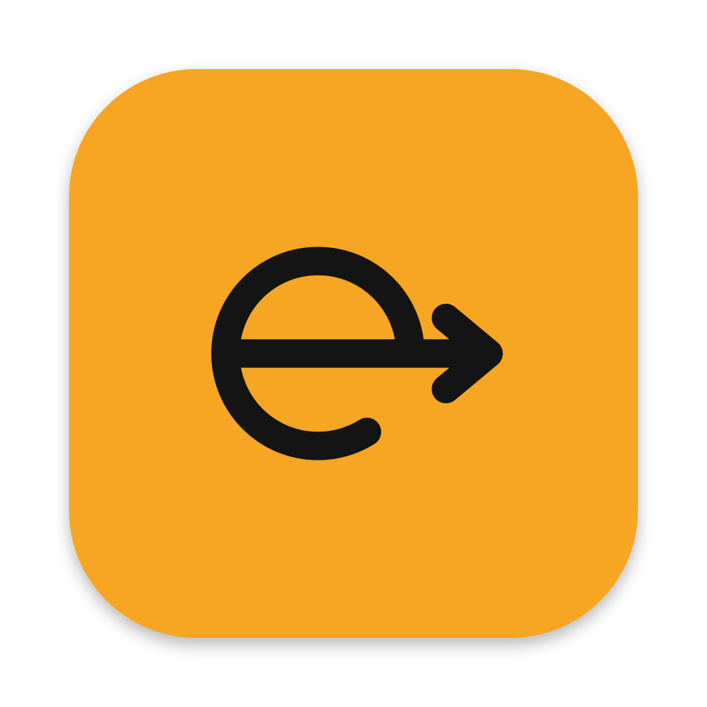
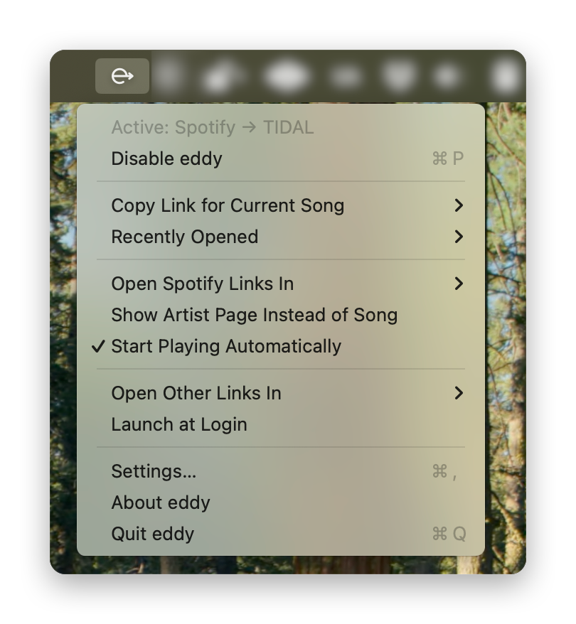

<div align="center">
  
  <h1>eddy</h1>
  <p><strong>Click a Spotify link anywhere on your Mac, and it opens in Apple Music or TIDAL.</strong></p>
</div>

https://github.com/user-attachments/assets/8459c138-5f37-4871-9260-f4773f569c3d

A friend sends you a Spotify link in Messages, Slack or Mail. Instead of Spotify's web player, the same song opens in your own streaming app, ready to play. Every other link goes to your normal browser, untouched.

> **Status: alpha.** Works daily on the developer's Mac; expect rough edges. macOS 13 or later.

## What it does



- **Spotify → Apple Music or TIDAL:** track and album links, including `spotify.link` short links and `spotify:` links, open in the Music or TIDAL app (the web player only if the app isn't installed). TIDAL matches are exact when you connect your TIDAL account; otherwise TIDAL opens a search.
- **Copy Link for Current Song** (menu, ⇧⌘C): copies a link to the song playing in TIDAL or Music, to share with a friend. Pick TIDAL, Apple Music or Spotify from the submenu; ⇧⌘C copies one for your own service.
- **Autoplay** (optional): presses Play once the song has opened.
- **Recently Opened** in the menu, Disable/Enable, Launch at Login.

Not converted yet: artists, playlists, podcasts (they open as usual).

## Install

1. Download the latest `eddy-…-macos.zip` from [Releases](https://github.com/RespectWood/eddy/releases), unzip it and move **eddy** to Applications.
2. Open eddy. macOS blocks it the first time, because this alpha isn't notarized by Apple: open **System Settings → Privacy & Security**, scroll down and click **Open Anyway**.
3. In the window that appears:
   - choose **Apple Music** or **TIDAL**;
   - TIDAL: click **Connect TIDAL** and log in, for exact matches;
   - pick your normal browser;
   - click **Use eddy for links** and confirm.
4. Optional: turn on **Start Playing Automatically**. macOS asks for the Accessibility permission.

eddy lives in the menu bar; it has no Dock icon.

## How it works

macOS sends clicked links to one app, the "default web browser". eddy takes that slot, but it isn't a browser:

- **Spotify links** are looked up and opened in your streaming app.
- **Every other link** goes straight to the browser you picked. eddy doesn't load it, check it or keep it.

Links you click *inside* your browser stay in the browser; eddy only sees links from other apps.

## Privacy

eddy has no server, no account of its own, no analytics and no tracking. Nothing is ever sent to the developer.

**What leaves your Mac, and only when needed:**

| When | Sent to | What |
|---|---|---|
| You click a Spotify link | Spotify (`open.spotify.com`; short links also their link service, e.g. `spotify.link`) | The link's ID, to read the song's title, artists and length |
| Converting to Apple Music | Apple (iTunes Search API) | Artist and title, your country |
| Converting to TIDAL | Deezer, then TIDAL | Artist and title (Deezer, for the song's ISRC code); the ISRC or a search and your country (TIDAL) |
| Copy Link for Current Song, and when you open eddy's menu (so your default link is ready) | Spotify links: Deezer, MusicBrainz, Spotify. Apple Music links: Apple. TIDAL links: Deezer, then TIDAL | Artist and title of the song playing, its ISRC code, your country (Apple Music, TIDAL) |

Like any app on the internet, these services see your IP address. Ordinary (non-Spotify) links cause no network traffic at all.

**What stays on your Mac:**

- Matches found, for up to 30 days, so the same link opens instantly (`~/Library/Application Support/eddy/cache.sqlite`). Older entries are deleted.
- Your last 10 conversions (Recently Opened) and your settings, in eddy's preferences.
- Your TIDAL login: access tokens and your account country, in the macOS Keychain, for this Mac only. eddy never sees your password: you log in on TIDAL's own page.

**Permissions** (all optional):

- **Accessibility**, asked when you turn on autoplay or copy a link while TIDAL is playing: to press Play and to read which song TIDAL is playing. Used for nothing else.
- **Automation → Music**, asked the first time you copy a link while Music is playing: to ask Music which song is playing.
- **Notifications**, asked when the setup window opens: to tell you when a link couldn't be matched exactly.

**Disconnect TIDAL:** Settings → Accounts → **Disconnect** deletes the login from your Mac, and eddy stops using your TIDAL account right away.

## Uninstall

1. If you connected TIDAL: Settings → Accounts → **Disconnect**.
2. Set your normal browser back in **System Settings → Desktop & Dock → Default web browser**.
3. Quit eddy from its menu and delete it from Applications.
4. Optional cleanup: remove eddy under **Privacy & Security → Accessibility**, delete `~/Library/Application Support/eddy`, and run `defaults delete com.respectwood.eddy` in Terminal to remove its settings.

## Building from source

Requirements: macOS 13+, the [Rust toolchain](https://rustup.rs) (stable), and the Xcode Command Line Tools (full Xcode not required).

```sh
cargo test                                  # unit tests (no network)
cargo test -- --ignored                     # live tests against Spotify, iTunes, Deezer
scripts/build-app.sh                        # → dist/eddy.app + zip (universal, hardened runtime)
ARCHS=arm64 scripts/build-app.sh            # faster, Apple silicon only
```

For **Connect TIDAL**, create a free app at [developer.tidal.com](https://developer.tidal.com), add the redirect URI `eddy://auth/tidal`, and put its client ID in `.env` (see `.env.example`) before building.

Try the core without the app:

```sh
cargo run -p eddy-cli -- parse "https://open.spotify.com/intl-de/track/4uLU6hMCjMI75M1A2tKUQC?si=x"
cargo run -p eddy-cli -- resolve "https://open.spotify.com/track/4uLU6hMCjMI75M1A2tKUQC" --to apple-music --country DE
```

Layout:

- `crates/eddy-core`: Rust library that parses links and finds them on other services
- `crates/eddy-cli`: command-line tool for development and testing
- `crates/eddy-ffi`: UniFFI bindings for Swift
- `macos/`: the Swift/SwiftUI menu bar app

[PLAN.md](PLAN.md) has the background and roadmap, [docs/tickets/](docs/tickets/) the current work, and [docs/manual-tests.md](docs/manual-tests.md) the checks before a release.

## Security

Found a vulnerability? Please report it privately, see [SECURITY.md](SECURITY.md).

## Trademarks

eddy is an independent project for personal use. It isn't affiliated with, endorsed or sponsored by Spotify, TIDAL or Apple. Their names are used only to describe which links eddy works with; the TIDAL logo in eddy's settings follows TIDAL's Design Guidelines.

## License

Licensed under either of

- Apache License, Version 2.0 ([LICENSE-APACHE](LICENSE-APACHE))
- MIT license ([LICENSE-MIT](LICENSE-MIT))

at your option.

Unless you explicitly state otherwise, any contribution you intentionally submit for inclusion in this work, as defined in the Apache-2.0 license, will be dual licensed as above, without any additional terms or conditions.
